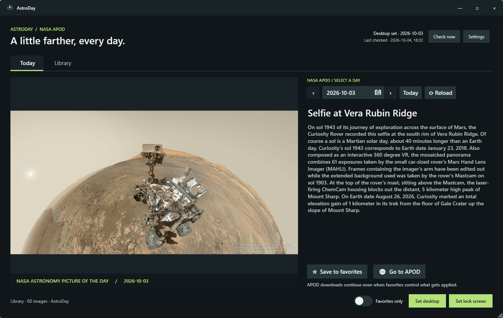
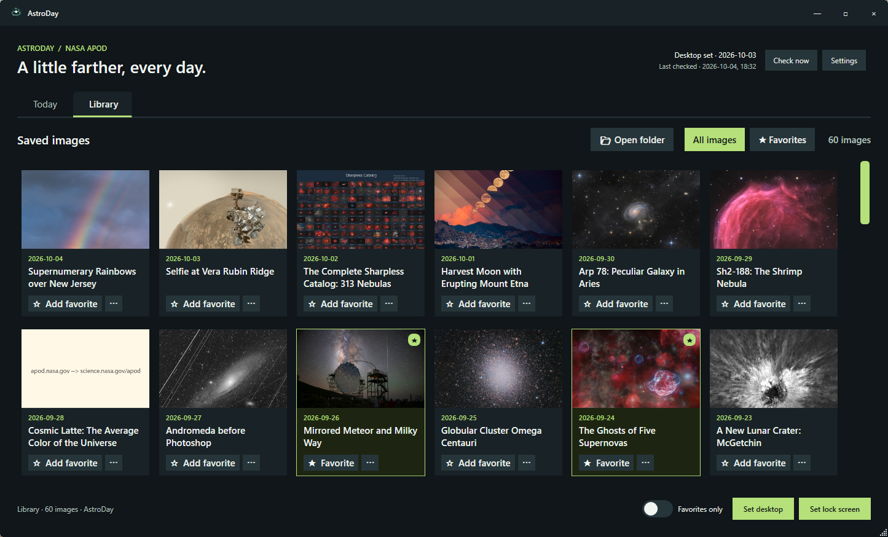

# AstroDay

AstroDay is a lightweight, tray-first Windows app for NASA's Astronomy Picture of the Day (APOD). It downloads the best available still image, keeps a local library, and can apply images to the Windows desktop and lock screen.

## Screenshots





Images shown are from NASA's Astronomy Picture of the Day (credit: NASA and the individual image authors).

## Features

- Today preview (double-click opens the image), date picker, and a library of downloaded images. Days are resolved in US Eastern time, as NASA publishes them.
- Configurable image sources, tried in your chosen order: NASA API (api key), NASA article search (works for past days without a key), and the NASA APOD webpage (today only).
- NASA API HTTP 429 rate limits are treated as recoverable and immediately fall through to the NASA article website/image scraper.
- Days without a still image (videos) are kept as text-only entries with title and description; **Go to APOD** opens the day on NASA's site.
- Missing, future, and unsupported-media APOD dates stay inline in the Today view without interrupting date browsing with an error dialog. NASA article images are recognized even when stored outside the traditional APOD year/month asset folders.
- Library cards: double-click opens the image, and the three-dot menu can set it as the desktop wallpaper, open it in Explorer, go to APOD, reload it, or remove it.
- Favorite buttons identify their current action on hover, including **Remove favorite** for saved items. Manual desktop and lock-screen actions use the image active in the current Today or Library view.
- Desktop wallpaper placement can either fill the screen (cropping when necessary) or fit the whole image while preserving its aspect ratio.
- If the latest APOD is not a still image, automatic checks search at most five previous days before leaving the current desktop unchanged.
- Checks for a new APOD at startup and every 6 hours (every 30 minutes until today's image is available).
- Favorites collection, visible favorites filter, and a shared **Favorites only** switch next to the apply buttons.
- When Favorites only is active, random favorites are used for timed wallpaper rotation and manual apply actions. The interval is configurable in minutes (60 by default); lock-screen rotation is optional.
- Custom image-library location, **Open folder** shortcuts, sign-in startup option, and close-to-tray preference.
- The installer supports an image-library location, safe in-place upgrades, icon-bearing shortcuts, optional sign-in startup, and launch-after-install in a window (default).
- Dark UI with six selectable accents (Mint, Sky, Violet, Amber, Coral, Lime), toggle-switch settings, themed scrollbars, and a planet-orbit loader.
- NASA API key protected with Windows DPAPI for the current user; existing plaintext keys are migrated when loaded.
- Checks GitHub Releases for updates at most once per day, with a manual **Check for updates** action in Settings and the tray menu.
- Update details include direct repository and release links plus a one-click installer download when a newer installer is available.

Dates use `yyyy-MM-dd`; local timestamps use `yyyy-MM-dd, HH:mm`.

## Requirements

- Windows 10 version 2004 (build 19041) or newer.
- .NET 10 SDK to build and run from source.
- Internet access to NASA for new images. Cached library items remain available offline.

**Framework support:** AstroDay targets .NET 10 LTS. Microsoft lists .NET 10 end of support as November 14, 2028. Keep the SDK/runtime current with Microsoft's servicing updates.

## Run and test

From the repository root:

```powershell
dotnet restore AstroDay.sln
dotnet run --project AstroDay.csproj
dotnet test AstroDay.sln --configuration Release
```

To verify formatting:

```powershell
dotnet format AstroDay.sln --verify-no-changes --no-restore
```

The app opens its window when started normally and adds a notification-area icon. By default, the window close button hides AstroDay to the tray; change **Close to the system tray instead of exiting** in Settings to make close exit the app. **Exit** in the tray menu always quits.

## Publish

Create a self-contained Windows x64 build with managed assemblies bundled into the apphost:

```powershell
dotnet publish AstroDay.csproj --configuration Release --runtime win-x64 --self-contained true /p:PublishSingleFile=true
```

Output is under `bin\Release\net10.0-windows10.0.19041.0\win-x64\publish`. WPF may emit native support DLLs (and a PDB) beside `AstroDay.exe`; distribute the complete publish folder. The release workflow also builds an Inno Setup installer with selectable program and image-library directories, the AstroDay orbit icon, optional Windows sign-in and desktop shortcuts, and launch-after-install enabled by default. Upgrades detect the previous version and stop AstroDay before replacing application files. The library remains outside the installer file set; changing folders preserves the old library and backs up conflicting target content. Test the published executable and installer on the Windows version you intend to support. Do not move a manually published executable after enabling sign-in startup; if you do, turn startup off and on again from Settings.

## Data and security

- Settings are stored at `%LOCALAPPDATA%\AstroDay\settings.json`.
- NASA images and `library.json` are stored in the selected library folder, defaulting to `Pictures\AstroDay`.
- Installer upgrades and uninstalls never delete the selected image-library folder or its contents. If a folder is changed, source and conflicting destination files are preserved.
- A user-provided NASA API key is protected using Windows DPAPI with current-user scope. This protects it at rest from other Windows users, but not from malware or processes running as the same user. Do not commit settings, API keys, library contents, or logs.
- Downloads require HTTPS, image URLs must be on NASA-owned hosts, returned APOD dates are validated, and a single image is limited to 100 MB.
- JSON settings and library indexes use same-directory temporary-file replacement. A malformed settings file or image index is preserved as a timestamped `.corrupt-*` recovery copy when possible.
- Unexpected exceptions are written to a rotating local log under `%LOCALAPPDATA%\AstroDay\logs`; API query keys are redacted from logged text.
- AstroDay does not open a network listener or send telemetry. NASA receives the API key with API requests.

See [SECURITY.md](SECURITY.md) for the security policy and [CONTRIBUTING.md](CONTRIBUTING.md) for development checks.

## Windows behavior

Desktop wallpaper changes use a Windows desktop API. Lock-screen personalization can be limited by Windows account, app packaging identity, or device policy; AstroDay reports failures, but this feature must be verified on the target device. Startup registration is per-user and writes the app executable path to the current user's Run key.

The shared NASA `DEMO_KEY` is rate-limited and often returns HTTP 429; add your own key in Settings, or rely on the article-search source. APOD sometimes publishes a video instead of a still image; AstroDay stores only the text for those days and never applies them as wallpaper.

## About

- Product version: `1.4.1`
- Application creation date: `2026-09-30`
- License: Apache License 2.0. See [LICENSE](LICENSE) and [NOTICE](NOTICE). The license does not grant rights to the AstroDay name.

The Settings drawer also shows the product version and creation date.

## Quality checks

The test suite covers favorite selection, DPAPI round-tripping, migration of legacy plaintext keys, malformed settings recovery, atomic JSON replacement, APOD page/article parsing, the Eastern-time APOD day, recent-image fallback, source-order persistence, and library save/reload/remove including text-only entries and data-preserving relocation. The window code and the download/fallback loop have no automated HTTP/UI tests. GitHub Actions runs formatting verification and the Release test suite on Windows for pushes and pull requests.

## Release checklist

- Run `dotnet format AstroDay.sln --verify-no-changes --no-restore` and `dotnet test AstroDay.sln --configuration Release`.
- Confirm the GitHub Actions workflow passes on Windows and publish from a clean tagged commit.
- Test a clean first launch, settings migration, an API outage (source fallback order), a video day, and browsing cached and uncached dates.
- Verify maximizing does not cover the taskbar.
- Verify favorites interval and target behavior, close-to-tray, startup registration, installer library selection, upgrade preservation, launch-after-install options, and Explorer shortcut.
- Verify desktop and lock-screen behavior on supported Windows versions and a managed-device scenario.
- Review `.gitignore` and make sure no API key, personal images, settings, logs, or build output will be committed.
- Build and test the published artifact, not only the development build.
- Add `docs/RELEASE-v<version>.md`, then push a matching `v`-prefixed tag (for example `v1.4.1`). Test builds use a `-test` suffix and are published as GitHub prereleases.
